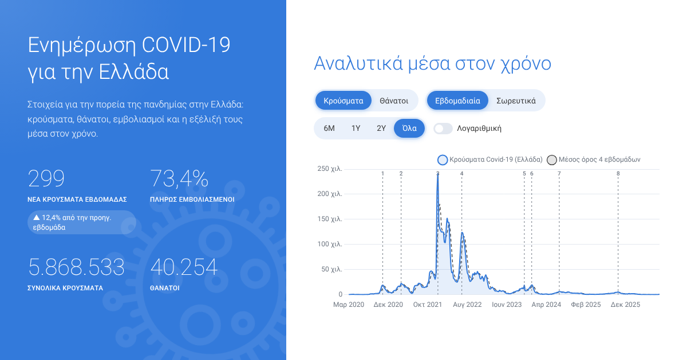

# COVID-19 Greece 🇬🇷

**Live site:** https://mikemich.github.io/covidgreece.com/

An interactive, bilingual (Ελληνικά / English) dashboard that tracks COVID-19 in Greece:
weekly cases and deaths, automatically detected pandemic waves, vaccination coverage,
hospital pressure, excess mortality and a per-capita comparison with other European
countries. The data refreshes itself every week through GitHub Actions.



## Features

| | |
|---|---|
| 📈 **Interactive main chart** | Cases or deaths · weekly or cumulative · 6M / 1Y / 2Y / all · log scale · 4-week average · tooltips |
| 🌊 **Wave detection** | Peaks are found algorithmically (topographic prominence on a ratio scale) and marked on the chart; each wave card zooms the chart to that period |
| 💉 **Vaccination** | Coverage bars and history for first dose, full course and boosters |
| 🏥 **Health-system impact** | Weekly hospital and ICU admissions, excess mortality vs. baseline |
| 🇪🇺 **Greece in Europe** | Ranked per-capita comparison (deaths, cases, vaccination, excess deaths) and deaths-per-million trend against 7 other countries and the EU |
| 🗓️ **Timeline** | Sourced milestones of the pandemic in Greece |
| 🔗 **Shareable views** | Chart state lives in the URL (`?metric=deaths&mode=cumulative&range=1y&lang=en`) |
| ⬇️ **Export** | Download the chart as PNG or the full weekly dataset as CSV; Web Share API with clipboard fallback |
| 🌍 **i18n** | Greek and English, with locale-aware number and date formatting (auto-detected, remembered) |
| 🌙 **Dark mode** | Follows the OS setting, with a manual toggle and no flash on load |
| 📱 **PWA** | Installable, works offline (service worker: network-first for data, cache-first for vendor files) |
| ♿ **Accessibility** | Semantic landmarks, skip link, keyboard-operable controls with `aria-pressed`, chart descriptions, data table alternative, `prefers-reduced-motion` support |
| 🔎 **SEO** | Open Graph / Twitter cards, canonical URL, `schema.org/Dataset` JSON-LD |

## Architecture

```
OWID compact CSV (WHO · ECDC · national sources)
        │  weekly GitHub Action (cron)
        ▼
scripts/build_data.py ── stream & filter → weekly buckets → wave detection → validation
        │
        ▼
docs/data/*.json  ──►  docs/ (static site, vanilla JS ES modules + Chart.js)  ──►  GitHub Pages
```

* **No build step, no framework.** The site is plain HTML/CSS and ES modules, so what is in
  `docs/` is exactly what is deployed. Chart.js 4 is vendored for reliability.
* **Python data pipeline using only the standard library.** It streams the ~180 MB source CSV,
  aggregates the WHO reports into Sunday-ending weeks (reports dated Sunday or the following
  Monday land in the same week), trims unreported trailing weeks, detects waves and validates
  the result (series lengths, monotonic weeks, plausibility checks) before writing anything.
  A failed validation fails the workflow, so bad data never reaches the site.
* **Idempotent builds.** `generated_at` is preserved when the numbers are unchanged, so the
  scheduled job only commits real updates.

### Wave detection

A week is a wave peak when weekly cases at least **doubled** from the trough before it and
**halved** to the trough after it (prominence measured as a ratio, not an absolute difference),
and the peak is at least 2 % of the all-time maximum. Using ratios keeps the small 2020 waves
visible next to the 240 000-cases-a-week Omicron peak.

## Project layout

```
docs/                     # the website (GitHub Pages root)
  index.html
  assets/css/style.css
  assets/js/app.js        # UI wiring, rendering, state
  assets/js/charts.js     # Chart.js theme, plugins and chart builders
  assets/js/i18n.js       # Greek / English strings
  assets/js/lib/          # pure, unit-tested helpers (formatting, URL state)
  data/                   # generated JSON + hand-curated milestones
  sw.js, manifest.webmanifest, 404.html
scripts/build_data.py     # data pipeline
tests/                    # pytest (pipeline) + node:test (front-end helpers)
.github/workflows/        # CI, weekly data refresh, Pages deploy
```

## Running locally

```bash
# serve the site
npx http-server docs -p 8080      # or: python -m http.server -d docs 8080

# rebuild the data (downloads the latest OWID dataset)
python scripts/build_data.py

# tests and lint
pip install -r requirements-dev.txt
pytest && ruff check scripts tests
npm test                          # Node 22+
```

## Deployment

1. In the repository go to **Settings → Pages** and set **Source: GitHub Actions**.
2. Push to `master`; the *Deploy to GitHub Pages* workflow publishes `docs/`.
3. The *Update data* workflow runs every Wednesday (or on demand from the Actions tab),
   commits fresh data when it changed and triggers a redeploy.

(Alternatively, *Deploy from a branch* with `master` / `/docs` also works, without the automatic
redeploy after data updates.)

If you serve the site from a custom domain such as `covidgreece.com`, add a `docs/CNAME` file
with the domain and update the absolute URLs in `docs/index.html` (canonical / Open Graph) and
`docs/404.html`.

## Data & credits

* Data: [Our World in Data – COVID-19](https://ourworldindata.org/coronavirus), compiled from the
  WHO, ECDC and national sources, licensed **CC BY 4.0**.
* Since 2023 countries report weekly, so every figure on the site is weekly. Confirmed cases
  undercount true infections, especially after mass testing ended. Recoveries are not shown
  because they stopped being reported reliably in 2021.
* Charts: [Chart.js](https://www.chartjs.org/) (MIT). Font: Roboto.

## History

The project started in 2020 as a Flask app reading `api.covid19api.com`. That API shut down in
2023, so v2 rebuilds the site as a static, self-updating GitHub Pages app while keeping the
original design: the blue statistics panel, the white chart panel, Roboto Light headings and
the hairline numbers.

---

Website by [mikemich](https://github.com/mikemich) · For information only; not medical advice.
